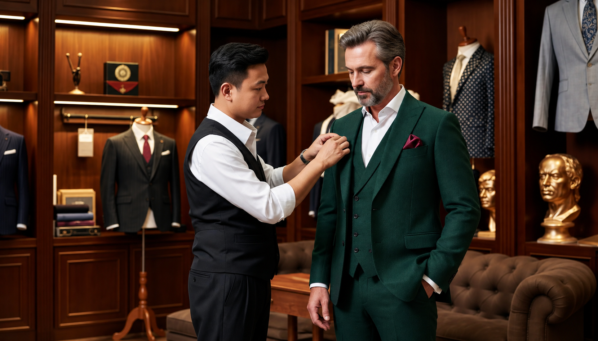

# Yêu cầu 14: Chuẩn hóa Banner + Concept-strip + Git Push

> Hồ sơ kế hoạch Yêu cầu 14. Cấu hình hiện hành, các biến thể v3.1/v3.2 và lịch sử mới nhất: [VERSION-STATUS](docs/VERSION-STATUS.md).

## Tóm tắt yêu cầu

- **Yêu cầu 1:** Chuẩn hóa aspect ratio: PC 7:4 · Tablet 5:3 · Mobile 4:5 (chỉ v2, v3, v4)
- **Yêu cầu 2:** Thay ảnh banner cho v2, v3, v4
- **Yêu cầu 3:** Xóa concept-strip — **ĐÃ HOÀN TẤT**
- **Yêu cầu 4:** Audit UX content enhancements (border-radius, màu sắc)
- **Yêu cầu 5:** Push lên GitHub

---

## Tổng quan ảnh có sẵn

### V2 (design-studio) — chỉ có 7x4 và 5x3
| Ratio | Source | Status |
|-------|--------|--------|
| 7:4 (PC) | `design-studio/pc/v2-design-studio-7x4.png` (1.9MB) | ✅ |
| 5:3 (Tablet) | `design-studio/tablet/v2-design-studio-5x3.png` (1.8MB) | ✅ |
| 4:5 (Mobile) | **THIẾU** — chỉ có `heritage-atelier-03-4x5.png` (2.2MB) trong mobile/ | ⚠️ |

### V3 (wedding-story) — đủ cả 3
| Ratio | Source | Status |
|-------|--------|--------|
| 7:4 (PC) | `wedding-story/pc/wedding-story-01-7x4.png` (2.4MB) | ✅ |
| 5:3 (Tablet) | `wedding-story/tablet/wedding-story-02-5x3.png` (2.5MB) | ✅ |
| 4:5 (Mobile) | `wedding-story/mobile/wedding-story-03-4x5.png` (2.4MB) | ✅ |

### V4 (modern-essentials) — đủ cả 3
| Ratio | Source | Status |
|-------|--------|--------|
| 7:4 (PC) | `modern-essentials/pc/modern-essentials-01-7x4.png` (2.3MB) | ✅ |
| 5:3 (Tablet) | `modern-essentials/tablet/modern-essentials-02-5x3.png` (2.4MB) | ✅ |
| 4:5 (Mobile) | `modern-essentials/mobile/modern-essentials-03-4x5.png` (2.4MB) | ✅ |

---

## Chi tiết thực hiện

### Bước 1: Copy ảnh vào assets

**V2 (design-studio) — dùng ảnh full-size:**
- Copy `design-studio/pc/v2-design-studio-7x4.png` → `assets/banners/design-studio-7x4.png`
- Copy `design-studio/tablet/v2-design-studio-5x3.png` → `assets/banners/design-studio-5x3.png`
- ⚠️ **Mobile 4:5 thiếu** — dùng tạm `design-studio/mobile/heritage-atelier-03-4x5.png` → `assets/banners/design-studio-4x5.png` (hoặc dùng ảnh mobile của v2 từ concept khác nếu có)

**V3 (wedding-story) — dùng ảnh full-size:**
- Copy `wedding-story/pc/wedding-story-01-7x4.png` → `assets/banners/wedding-story-7x4.png`
- Copy `wedding-story/tablet/wedding-story-02-5x3.png` → `assets/banners/wedding-story-5x3.png`
- Copy `wedding-story/mobile/wedding-story-03-4x5.png` → `assets/banners/wedding-story-4x5.png`

**V4 (modern-essentials) — dùng ảnh full-size:**
- Copy `modern-essentials/pc/modern-essentials-01-7x4.png` → `assets/banners/modern-essentials-7x4.png`
- Copy `modern-essentials/tablet/modern-essentials-02-5x3.png` → `assets/banners/modern-essentials-5x3.png`
- Copy `modern-essentials/mobile/modern-essentials-03-4x5.png` → `assets/banners/modern-essentials-4x5.png`

### Bước 2: Cập nhật banner-config.js

Cần xác định dimensions + subject bounding boxes cho từng ảnh. Sau đó cập nhật `window.DUNNIO_BANNERS`:

**Cấu trúc cần cập nhật cho mỗi concept (2 slides):**

```javascript
"design-studio": [
  { // Slide 1
    alt: "...",
    desktop: { src: "assets/banners/design-studio-7x4.png", width: W, height: H, subject: [x1, y1, x2, y2] },
    tablet: { src: "assets/banners/design-studio-5x3.png", width: W, height: H, subject: [x1, y1, x2, y2] },
    mobile: { src: "assets/banners/design-studio-4x5.png", width: W, height: H, subject: [x1, y1, x2, y2] },
    compact: { src: "assets/banners/design-studio-4x5.png", width: W, height: H, subject: [x1, y1, x2, y2] }
  },
  { // Slide 2 — dùng ảnh variant khác nếu có
    ...
  }
]
```

### Bước 3: Cập nhật 5 file HTML (v2, v3, v4)

Mỗi file có `<picture data-banner="...">` trong hero-media. Cập nhật `<source>` và ``:

**V2 (design-studio):**
```html
<picture data-banner="design-studio">
  <source data-device="compact" media="(max-width: 639px) and (max-height: 760px)"
    srcset="assets/banners/design-studio-4x5.png" width="800" height="1000">
  <source data-device="mobile" media="(max-width: 639px)"
    srcset="assets/banners/design-studio-4x5.png" width="800" height="1000">
  <source data-device="tablet" media="(max-width: 1199px)"
    srcset="assets/banners/design-studio-5x3.png" [dimensions]>
  
</picture>
```

**Tương tự cho v3 và v4.**

### Bước 4: Cập nhật banner-layout.json (nếu cần)

Thêm dimensions cho device types mới (4x5) vào `devices`.

### Bước 5: Audit UX (Yêu cầu 4)

Bổ sung visual enhancements cho các section nội dung:
- Border-radius cho cards, images
- Màu sắc nổi bật theo brand palette
- Shadows, hover effects
- Focus states

### Bước 6: Git push

```bash
git add .
git commit -m "Yêu cầu 14: Chuẩn hóa banner ratio v2/v3/v4, xóa concept-strip, audit UX enhancements"
git push origin main
```

---

## Files cần sửa đổi

| File | Hành động |
|------|-----------|
| `assets/banners/design-studio-7x4.png` | Copy từ source |
| `assets/banners/design-studio-5x3.png` | Copy từ source |
| `assets/banners/design-studio-4x5.png` | Copy tạm từ heritage-atelier |
| `assets/banners/wedding-story-7x4.png` | Copy từ source |
| `assets/banners/wedding-story-5x3.png` | Copy từ source |
| `assets/banners/wedding-story-4x5.png` | Copy từ source |
| `assets/banners/modern-essentials-7x4.png` | Copy từ source |
| `assets/banners/modern-essentials-5x3.png` | Copy từ source |
| `assets/banners/modern-essentials-4x5.png` | Copy từ source |
| `assets/banner-config.js` | Cập nhật src + dimensions + subject |
| `assets/banner-layout.json` | Thêm device 4x5 dimensions |
| `v2-design-studio.html` | Cập nhật `<picture>` sources |
| `v3-wedding-story.html` | Cập nhật `<picture>` sources |
| `v4-modern-essentials.html` | Cập nhật `<picture>` sources |
| `assets/brand.css` / `styles.css` | Audit UX enhancements |

---

## Verification

1. Mở từng trang (v2, v3, v4) ở 3 viewport: PC 1440px, Tablet 820px, Mobile 390px
2. Banner hiển thị đúng aspect ratio: 7:4 (PC), 5:3 (Tablet), 4:5 (Mobile)
3. Không còn concept-strip ở đầu trang
4. `git push` thành công lên GitHub
