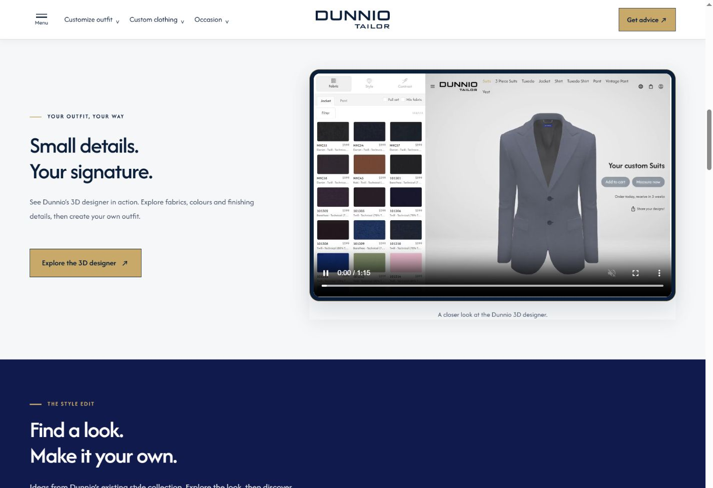
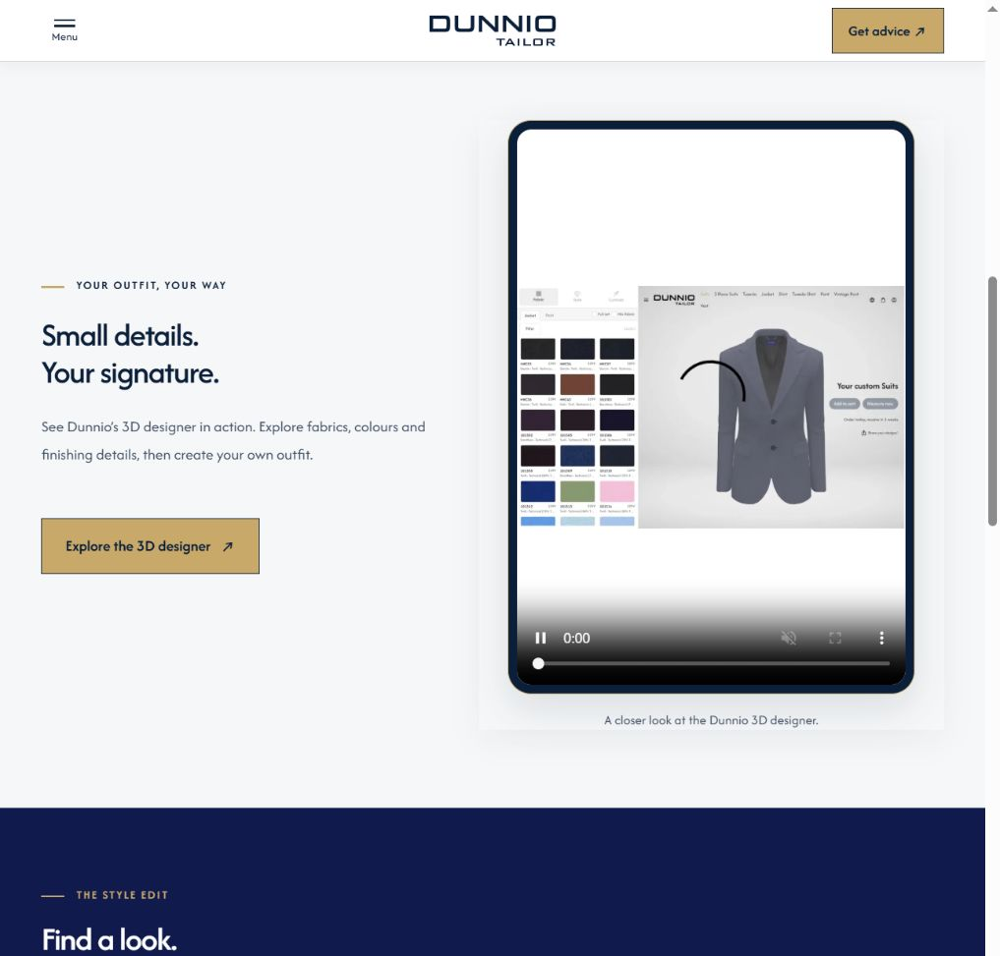
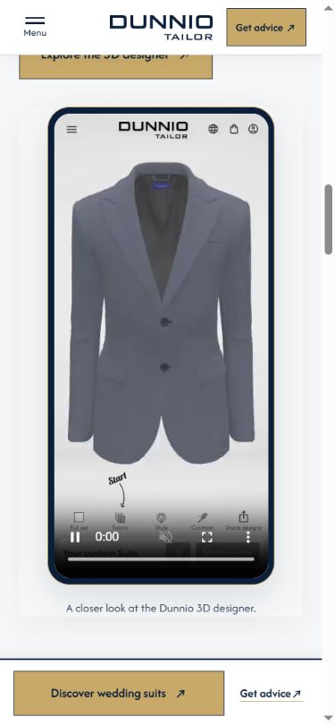

# Yêu cầu 21 — Video demo Custom Outfit 3D

Cập nhật 15/10/2026. Áp dụng cho **v3.1 Wedding Story** và **v3.2 Wedding Story**, trong `.studio-board` của `.section.studio-section`. Bản v2 giữ bộ chọn style cũ.

| Thiết bị | Chiều rộng viewport CSS | Video | Kích thước | Tỉ lệ | Thời lượng | Dung lượng |
|---|---|---|---|---|---|---|
| PC | ≥1200px | `dunnio-custom-outfit-desktop.mp4` | 1600×1000 | 8:5 | 75,96 giây | 731.801 byte |
| Tablet | ≥640px và <1200px | `dunnio-custom-outfit-tablet.mp4` | 834×1194 | 139:199 | 74,12 giây | 702.521 byte |
| Mobile | <640px | `dunnio-custom-outfit-mobile.mp4` | 390×844 | 195:422 | 62,32 giây | 214.684 byte |

Nguồn: `C:/laragon/www/Banner-dunnio/mp4-demo-custom-3d-outfit/Dunnio_Custom_Outfit_PC.mp4`, `Dunnio_Custom_Outfit_Tablet.mp4`, `Dunnio_Custom_Outfit_Mobile.mp4`. Đã đọc stream metadata bằng FFmpeg và xác nhận kích thước/thời lượng qua trình duyệt. Cả ba dùng H.264 High, yuv420p, 25fps và không có track âm thanh. File website được sao chép nguyên byte; [manifest nguồn và SHA-256](studio-video-assets.json).

## Khung và bố cục

Video hiển thị `width:100%; height:auto; object-fit:contain`, giữ toàn bộ nội dung giao diện thay vì crop. Khung PC ngang; Tablet dọc tối đa 420px; Mobile dùng viền điện thoại, rộng tối đa 320px và giới hạn theo 68svh để khung vừa vùng nhìn khi cuộn tới video. Không thêm notch phủ lên nội dung ghi hình.

PC/Tablet: phần giới thiệu và CTA bên trái, video bên phải. Mobile: giới thiệu/CTA rồi tới khung video ở giữa. Nút **Explore the 3D designer** dẫn tới trang thật `https://dunniotailor.com/3d-custom-outfit/suits.html`. Bộ chọn màu/chi tiết và ghi chú “Interactive style preview” cũ đã được thay bằng nội dung demo video.

Tham khảo [Hockerty](https://www.hockerty.com/en-us/), `.designer .image`: video inline, muted, loop với nguồn desktop/mobile. Dunnio sử dụng **ba video do người dùng cung cấp**, theo ba kích thước, không sao chép nội dung video Hockerty.

## Phát và tải video

- Mỗi trang có **một** phần tử video. `assets/studio-video.js` chọn nguồn theo hai breakpoint 640/1200, cập nhật width/height và poster; resize qua breakpoint sẽ đổi nguồn và bắt đầu bản ghi tương ứng từ đầu.
- `preload="none"` ở đầu trang; khi cuộn gần video (240px) mới tải metadata. Khi ít nhất 20% khung video vào vùng nhìn, video phát tự động không tiếng và lặp lại nếu trình duyệt cho phép.
- Tạm dừng khi ra khỏi vùng nhìn hoặc chuyển tab. Nếu người xem chủ động dừng bằng điều khiển, video tiếp tục giữ trạng thái dừng khi cuộn trở lại. Điều khiển native có thể phát/dừng, tua và mở toàn màn hình.
- Tôn trọng `prefers-reduced-motion` và `Save-Data`: không chủ động autoplay; vẫn có thể bấm phát. Nếu autoplay bị chặn, nút native vẫn hoạt động.
- Poster WebP được trích từ giây đầu của từng video; không nhúng chữ/CTA vào poster. Có link mở file khi lỗi và các link video trong `noscript`.

## Mã nguồn và tái tạo

- `tools/build-wedding-variants.cjs`: markup video và intro/CTA của hai biến thể.
- `assets/wedding-variants.css?v=request21-r1`: khung và bố cục scoped Wedding Story. `assets/studio-video.js?v=request21-r1`: chọn nguồn và phát/dừng. Các cặp media range không để khoảng hở ở chiều rộng CSS có phần thập phân.
- `node tools/prepare-studio-videos.cjs`: sao chép nguồn và trích poster. Cần FFmpeg; chỉ định `DUNNIO_FFMPEG_PATH` khi binary không ở đường dẫn `.local` mặc định. `DUNNIO_STUDIO_VIDEO_SOURCE` chỉ định thư mục nguồn khác. Website đã có các asset hoàn chỉnh, không cần FFmpeg để chạy.
- `node tools/build-wedding-variants.cjs`: dựng lại v3.1/v3.2. `node tools/build-version-status-docs.cjs`: đồng bộ hồ sơ hiện hành.
- [Kiểm tra video](studio-video-verification.json): 16 trường hợp, hai biến thể × tám viewport, gồm 320/390/639/640/1032/1199/1200/1440px; đúng nguồn, kích thước gốc, tỉ lệ khung, không lỗi video/tràn ngang và hash nguồn khớp. Script `tools/verify-studio-videos.cjs` đọc ma trận quan sát browser tại `DUNNIO_STUDIO_MATRIX` hoặc `.local/studio-video/matrix.json`.

Kiểm tra bằng Chrome desktop responsive; chưa kiểm tra iOS/Android thật. Các chế độ reduced-motion/Save-Data đã được xử lý trong code, chưa mô phỏng riêng trên browser. Các số đo banner và kiểm tra footer trước đó vẫn là bằng chứng theo thời điểm, không tuyên bố đã chạy lại toàn bộ suite sau thay đổi video.

## Minh họa đã kiểm tra

