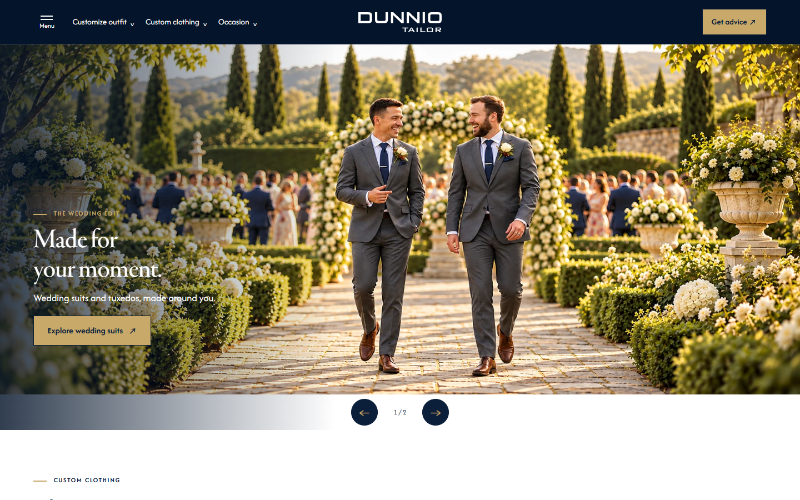
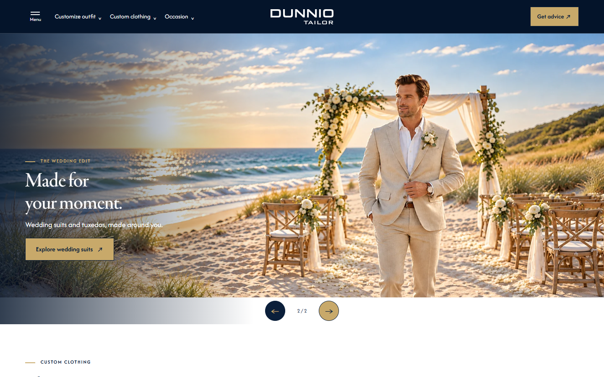
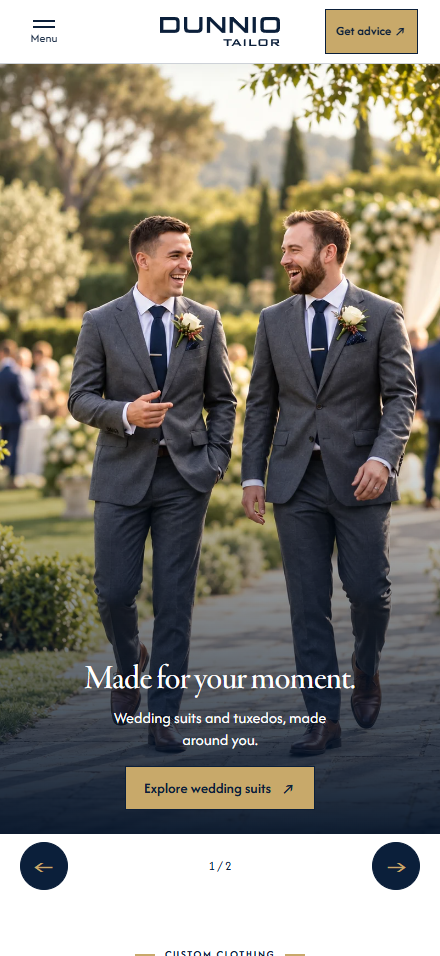

# Trạng thái hiện hành của các phiên bản Dunnio Tailor

Cập nhật **16/10/2026 · giờ Việt Nam**. v3.2 đã áp dụng bản final **Yêu cầu 22**; studio video giữ từ **Yêu cầu 21**. [Chi tiết bản final](WEDDING-FINAL-REQUEST22.md). Tài liệu này ưu tiên hơn các thông số lịch sử Yêu cầu 11–21 khi có khác biệt về Wedding Story. Đây là thông số bản demo đã triển khai, không phải phương án viewport tự co chiều cao được đề xuất trong báo cáo Hockerty.

## 1. URL và khung banner đang dùng

Breakpoint chọn nguồn ảnh: **PC ≥1200px**, **Tablet 640–1199px**, **Mobile ≤639px**, theo chiều rộng CSS viewport. Breakpoint của từng lưới nội dung có thể khác, ví dụ USP chuyển hai cột dưới 1024px.

| Phiên bản | PC | Tablet | Mobile | Điểm khác biệt |
|---|---|---|---|---|
| [v1 Heritage Atelier](../v1-heritage-atelier.html) | Slide 1: 1659×948, gần 7:4; slide 2: 1619×971, gần 5:3 | Hoán đổi hai ảnh PC | SVG 800×1422; compact 800×1000 | Bộ editor chung |
| [v2 Design Studio](../v2-design-studio.html) | 3 ảnh 1600×914, gần 7:4 | 3 ảnh 1600×960, 5:3 | 2 ảnh 1122×1402; slide đầu thiếu ảnh dọc riêng | Giữ bộ nguồn hiện có |
| [v3 Wedding Story](../v3-wedding-story.html) | 1600×914, gần 7:4 | 1600×960, 5:3 | 1122×1402, gần 4:5 | Bản gốc, không đổi theo v3.2 |
| [v3.1 Wedding Story](../v3.1-wedding-story.html) | 1600×914, gần 7:4 | 1600×960, 5:3 | Khung 4:5, nguồn 1122×1402 | Copy dưới ảnh trên mobile; có Wedding party và FAQ |
| [v3.2 Wedding Story](../v3.2-wedding-story.html) | **Khung 7:4**, nguồn **1600×914** | **5:3**, nguồn **1600×960** | **Khung hướng tới 4:7**, nguồn **1122×1402** | Copy trong ảnh mobile; bỏ Wedding party và FAQ |
| [v4 Modern Essentials](../v4-modern-essentials.html) | 1600×914, gần 7:4 | 1600×960, 5:3 | 1122×1402, gần 4:5 | Giữ nguyên |
| [v5 Fit Concierge](../v5-fit-concierge.html) | Như bộ editor v1 | Hoán đổi hai ảnh PC | SVG 800×1422; compact 800×1000 | Giữ nguyên |

Các kích thước và cấu hình từng slide nằm trong [manifest JSON](VERSION-STATUS.json). “Tỉ lệ ảnh nguồn” và “tỉ lệ khung” được ghi riêng khi khác nhau.

## 2. Hai ảnh PC hiện hành của v3.2

| Slide | Nội dung | File đang phát | Kích thước / dung lượng |
|---|---|---|---|
| 1 | Hai người trong vườn cưới — nguồn v3.1 | [wedding-story-a-7x4.webp](../assets/banners/wedding-story-a-7x4.webp) | 1600×914 / 209.7 KiB |
| 2 | Chú rể bên bãi biển — nguồn v3.1 | [wedding-story-b-7x4.webp](../assets/banners/wedding-story-b-7x4.webp) | 1600×914 / 99.6 KiB |

Hai file PC hiện tại dùng chung nguồn với v3.1; không xử lý lại ảnh. Nguồn 1600×914 gần 7:4; CSS v3.2 khóa khung 7:4 và dùng contain. Các ảnh 3:2, 16:7 và 02-new vẫn lưu làm lịch sử nhưng không còn được v3.2 nạp để phát banner. Tablet/Mobile giữ bộ nguồn gốc.

## 3. Bố cục Wedding Story v3.1 và v3.2

**Yêu cầu 23–24:** v3.2 thu USP về **180×180px** chỉ trên PC ≥1200px, căn giữa bốn ô; Tablet/Mobile giữ kích thước và màu hiện có. Cụm CTA cuối trang thêm **Fit Guarantee**, chữ một dòng, dẫn đến trang đảm bảo độ vừa vặn. [Chi tiết và biên bản](WEDDING-USP-FIT-UPDATE.md). CSS v3.2 revision **request23-24-r1**; JS/app.js vẫn request22-r1.

Thứ tự: **hero → Wedding party (chỉ v3.1) → products → studio → looks → craft → customer reviews → Style Gallery → FAQ (chỉ v3.1) → closing → USP → footer**.

- Products/looks/craft và cấu trúc studio ban đầu dựa trên v2; studio-board nay đã thay bằng video demo theo Yêu cầu 21; bỏ service-section và phần products .fine. Nội dung craft nhấn mạnh thợ may Việt Nam với 15 năm kinh nghiệm.
- v3.1 giữ hàng nút banner 64px, nút 48×48px căn giữa. v3.2 bỏ banner-controls, tự chuyển mỗi 6 giây; chỉ còn nút dừng/phát nhỏ trên ảnh.
- v3.1 mobile: ảnh 4:5 → nút → hero-copy trên nền trắng. Wedding party cuộn ngang.
- v3.2 mobile: chữ/CTA gần chân ảnh, ẩn hero eyebrow. Khung 4:7 có chiều cao max(240px,min(W×7/4,100svh−64px)), W là chiều rộng vùng ảnh; không còn hàng nút dưới ảnh. Nguồn gần 4:5 được cover và căn center 35%.
- Eyebrow mobile có hai gạch cân đối; riêng v3.2 dùng 16px và mô tả p trong main 14px. Review một hàng không tự chạy: v3.1 giữ prev/next, v3.2 dùng cuộn ngang và nút feedback ở dưới; ảnh/tên/ngày/rating từ nguồn review, đoạn giới thiệu có nhãn Review summary.
- Gallery: bảy ảnh trên PC/Tablet, bốn ảnh trong lưới 2×2 mobile; giảm chiều cao để gom tiêu đề, mô tả, ảnh và See more gallery. Font/zoom lớn vẫn có thể cần cuộn.
- v3.2 đã bỏ mô tả p và Learn more trong USP, căn số/tiêu đề giữa các ô vuông đồng kích thước. Products/looks/community bỏ các rail-controls, looks bỏ fine, craft bỏ detail-line; CTA studio Mobile căn giữa. All outfit ideas thành nút gold/dark-blue; Read customer reviews ở giữa dưới review rail, cùng kiểu nút Gallery.
- USP mobile: 01/04 nền navy **#0b1f3a**, chữ gold **#C8A96A**; 02/03 nền gold, chữ navy. Bố cục hai cột tạo đường chéo. PC/Tablet giữ màu xen kẽ 01/03 navy, 02/04 gold; breakpoint bố cục lưới độc lập với breakpoint ảnh.
- Header và logo trong drawer của hai biến thể không dẫn về index. Footer được giữ nguyên theo yêu cầu ban đầu, bao gồm các liên kết vốn có của footer.

- **Studio video — Yêu cầu 21:** thay bộ chọn style bằng video Custom Outfit 3D: PC **1600×1000 (8:5)**, Tablet **834×1194 (139:199)**, Mobile **390×844 (195:422)**. Một player chọn một nguồn theo breakpoint 640/1200px; khung contain giữ trọn nội dung, native controls, muted/loop/playsinline. Tải khi cuộn gần, phát khi nhìn thấy; tạm dừng ngoài viewport, giữ trạng thái user pause; reduced-motion/Save-Data không autoplay. [Chi tiết và quy trình](STUDIO-VIDEO-UPDATE.md) · [Nguồn/SHA-256](studio-video-assets.json) · [Kiểm tra 16 trường hợp](studio-video-verification.json).

## 4. Chiều cao banner PC v3.2 và giới hạn một màn hình

Header PC **80px**, không còn hàng nút 64px dưới ảnh. H=W×4/7; tổng thường là 80+H. Với W=1440px, tổng khoảng 902,9px; W=1920px tổng khoảng 1177,1px. Scrollbar có thể giảm W. Bản final giữ 7:4 do người dùng chọn, không tự co ảnh PC để vừa mọi viewport thấp.

## 5. Nguồn chỉnh sửa và quy trình cập nhật

1. Cấu hình chung: `assets/banner-config.js`. v3.2 không còn nạp override 16:7; dữ liệu PC dùng chung v3.1. `assets/wedding-final.js` quản lý autoplay và sự kiện slide-step của app.js.
2. `assets/wedding-variants.css` chứa baseline của hai biến thể; wedding-final.css ghi đè riêng v3.2 sang PC 7:4, bỏ hàng nút và điều chỉnh mobile/section. Không đổi bộ Tablet/Mobile nếu chỉ thay ảnh PC.
3. Đồng bộ ảnh fallback đầu tiên và width/height trong `tools/build-wedding-variants.cjs`, rồi chạy `node tools/build-wedding-variants.cjs`. Generator này dựng lại v3.1/v3.2 từ v2/v3; không chỉ sửa HTML đầu ra rồi bỏ quên generator.
4. Khi thay URL/config ảnh, tăng revision script. CSS/video chung vẫn request21-r1. Riêng v3.2 nạp wedding-final.css revision request23-24-r1; wedding-final.js và app.js giữ revision request22-r1.
5. Chạy `node tools/verify-wedding-v32-banners.cjs` với HTTP preview đang phục vụ dự án. `DUNNIO_PREVIEW_URL` đổi địa chỉ kiểm thử; `DUNNIO_VERIFICATION_OUTPUT` đổi file kết quả. Dữ liệu phân biệt `viewport.width/height` với `width/height` của ảnh hiển thị.
6. Chạy `node tools/build-version-status-docs.cjs` để dựng lại tài liệu này và manifest. Khi sửa dữ liệu/mẫu của báo cáo Hockerty lịch sử, dùng `node tools/build-hockerty-audit-report.cjs`.
7. Commit các file thuộc bản sửa, push main, chờ Pages báo built cho đúng commit và kiểm tra URL online. Git push thành công chưa đồng nghĩa Pages đã triển khai xong.

Các generator cũ `tools/fashion-heroes.cjs`, `tools/build.cjs`, `tools/update-balanced-docs.cjs` phục vụ các bước trước; đọc phạm vi trước khi chạy để tránh tái tạo hero/hướng dẫn theo thông số cũ. SVG/ZIP vùng an toàn trong banner-templates là tư liệu trước Yêu cầu 17, chưa phải template của bố cục final hiện hành.

## 6. Bằng chứng và trạng thái kiểm tra

- [Bản final v3.2](wedding-final-verification.json): 11 viewport 320–1920px, khung banner, vị trí CTA, ô USP vuông, typography Mobile, cấu trúc đã tinh giản, autoplay 6 giây, dừng và cuộn ngang bằng bàn phím. Biên bản banner 15/10 vẫn được lưu làm lịch sử.
- [Kiểm tra cấu trúc hai biến thể ngày 14/10](wedding-story-verification.json) và [footer/USP ngày 14/10](wedding-footer-verification.json) là bằng chứng theo thời điểm, không tự coi là đã chạy lại toàn bộ sau mỗi lần thay ảnh PC.
- Vấn đề footer trong DevTools iPad đã được người dùng xác nhận cuộn được khi chọn **Fit to window**; không có thay đổi nội dung footer để xử lý việc canvas bị cắt ở mức 75%.
- [Báo cáo Hockerty Yêu cầu 19](hockerty-banner-audit-20261015.html) giữ số đo Dunnio PC **3:2 tại thời điểm khảo sát**. Không dùng các con số đó làm số đo của v3.2 7:4 final đang chạy.
- Kiểm tra responsive dùng Chrome desktop; chưa xác nhận thiết bị thật, Safari, screen reader, mạng di động hoặc conversion uplift.
- [Kiểm tra tài liệu](documentation-verification.json): liên kết nội bộ, mục lục, ảnh minh họa, không tràn ngang ở PC/Mobile và bộ tính 7:4 final với hàng nút 0px. Chạy lại bằng `node tools/verify-current-docs.cjs` với HTTP preview; `DUNNIO_DOCUMENTATION_OUTPUT` chỉ định nơi lưu kết quả khi kiểm tra online.

## 7. Ảnh chụp trước Yêu cầu 22 — hồ sơ lịch sử

Các ảnh 02-new bên dưới thuộc bước trước. [Minh họa và thông số final 7:4](WEDDING-FINAL-REQUEST22.md) là tham chiếu hiện hành.

## 8. Lịch sử quyết định banner v3.2

| Bước | Trạng thái |
|---|---|
| Yêu cầu 17 | Tạo v3.1/v3.2; cơ sở PC 7:4, Tablet 5:3; mobile v3.1 4:5, v3.2 hướng tới 4:7 |
| Yêu cầu 18 | Đã từng chuyển riêng PC v3.2 sang 3:2, nguồn 1536×1024 |
| Cập nhật tiếp theo | Đã từng chuyển PC v3.2 sang 5:3, dùng chung nguồn Tablet |
| Yêu cầu 19 | Khảo sát Hockerty, báo cáo và đề xuất; không triển khai cơ chế viewport của đề xuất |
| Yêu cầu 20 — b621c39 | PC 16:7, nguồn mới 1896×829 |
| Yêu cầu 22 — final | PC 7:4 dùng nguồn v3.1; bỏ banner-controls, autoplay 6s; tinh gọn rails/craft/community/USP và typography Mobile |
| Yêu cầu 21 | Studio-board v3.1/v3.2 thay bằng ba video MP4 theo thiết bị; cấu hình banner giữ nguyên |
| Thay ảnh — 233efc0 | Thay riêng slide 1 PC từ ảnh 02 sang **02-new**; Tablet/Mobile và slide 2 PC giữ nguyên |
