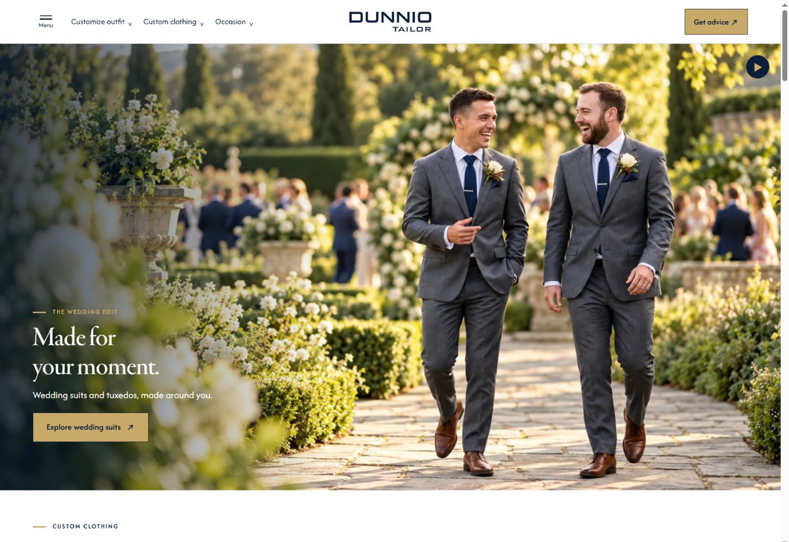
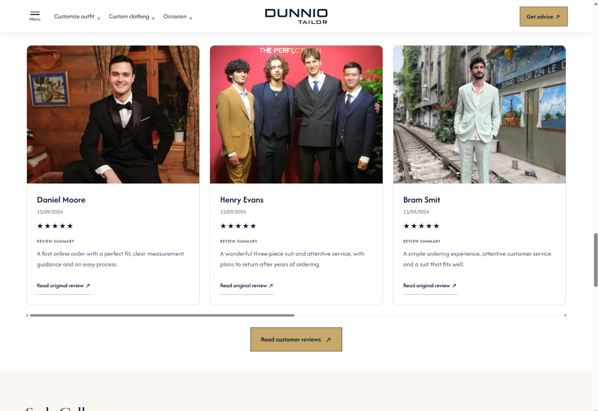
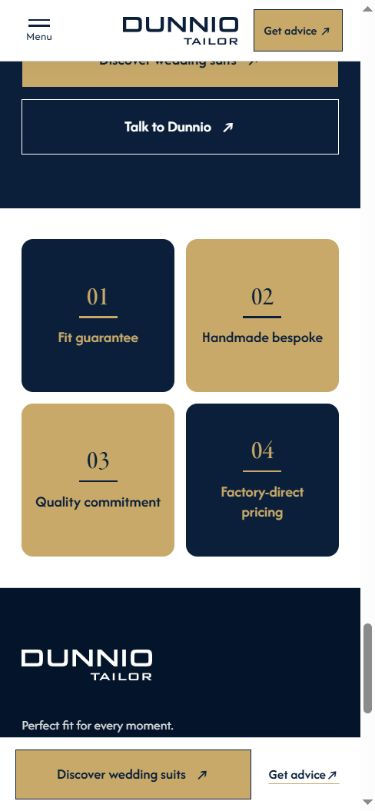

# Yêu cầu 22 — Wedding Story v3.2 final

Ngày cập nhật: **16/10/2026**, giờ Việt Nam. Áp dụng riêng [v3.2](../v3.2-wedding-story.html); v3.1 giữ nguyên HTML và bố cục của Yêu cầu 21.

**Bổ sung Yêu cầu 23–24:** USP PC ≥1200px hiện là 180×180px; Tablet/Mobile giữ nguyên. Nút “See how we ensure your fit” nằm dưới bốn ô USP, ngoài closing. CSS hiện dùng revision `request23-24-r2`; JS giữ `request22-r1`. [Chi tiết cập nhật](WEDDING-USP-FIT-UPDATE.md). Các ảnh và biên bản Yêu cầu 22 bên dưới mô tả thời điểm trước bổ sung này.

| Hạng mục | Cấu hình final |
|---|---|
| Banner PC ≥1200px | Khung **7:4**, dùng lại `wedding-story-a-7x4.webp` và `wedding-story-b-7x4.webp` của v3.1, nguồn 1600×914 |
| Banner Tablet 640–1199px | **5:3**, nguồn 1600×960, giữ hai cảnh gốc |
| Banner Mobile <640px | Hướng tới **4:7**, nguồn gần 4:5 được cover; chiều cao `max(240px, min(W×7/4, 100svh−64px))`, W là chiều rộng vùng ảnh |
| Điều khiển banner | Bỏ `.banner-controls`; tự chuyển mỗi **6000ms**, không có hàng nút 64px dưới ảnh |
| Products | Bỏ `.rail-controls`; giữ cuộn ngang, gap từ section-head xuống rail 20px PC/Tablet, 16px Mobile |
| Studio | Giữ ba video theo thiết bị; CTA nằm giữa trên Mobile |
| Looks | Bỏ `.rail-controls` và `.fine`; gap 20/16px; All outfit ideas trở thành nút nền gold #C8A96A, chữ dark-blue #111a4c |
| Craft | Bỏ `.detail-line`; giảm khoảng cách dưới heading, giữa mô tả và các link; thu gọn padding section |
| Community | Bỏ `.actions` và `.rail-controls`; giữ review rail cuộn ngang; một nút Read customer reviews nằm giữa, dưới rail, cùng kiểu gold/navy với See more gallery |
| USP | Bỏ toàn bộ mô tả p và `.text-link`; giữ số thứ tự và h3, căn giữa trong bốn ô vuông bằng nhau |
| Typography Mobile | Eyebrow **16px**, mô tả p trong main **14px**; section-desc 14px; footer giữ nguyên |

## Cơ chế slideshow của Yêu cầu 22 — lịch sử

**Đã thay thế trong [Yêu cầu 25](WEDDING-AUTOSLIDE-REQUEST25.md):** không còn nút play/pause; tự chuyển 6 giây và kéo/vuốt hai chiều. CSS/JS hiện là request25-r1. Mô tả và bằng chứng bên dưới lưu theo thời điểm Yêu cầu 22.

Banner tự đổi cảnh bằng timer 6 giây. Có nút dừng/phát 44px trên ảnh, không tái tạo prev/next hoặc counter. Tự tạm dừng khi ảnh nằm ngoài viewport, tab bị ẩn, con trỏ hover trên banner hoặc focus đang ở CTA. Thiết lập reduced-motion khởi đầu ở trạng thái dừng; người xem có thể chủ động phát.

`assets/app.js` nhận sự kiện `dunnio:banner-step`, duy trì cùng chỉ số slide khi resize và tiếp tục chọn đúng nguồn ảnh theo thiết bị. Timer nằm trong `assets/wedding-final.js`, chỉ tìm banner v3.2 có `data-autoplay-delay`. v3.1 vẫn dùng hai nút thủ công hiện có. Dữ liệu `data-slide`/`data-autoplay-transitions` phục vụ kiểm tra trạng thái, không phải analytics.

## Bố cục và khả năng thao tác

**Cập nhật Yêu cầu 26:** nút Read customer reviews dưới review rail cùng wrapper đã bỏ; giữ liên kết Read original review của sáu thẻ. Section được thu gọn còn padding PC/Tablet 48px trên / 40px dưới, Mobile 32px / 24px; padding cuối rail 8px. CSS hiện là request26-r1. [Biên bản mới](community-spacing-verification.json). Mô tả và ảnh Yêu cầu 22 lưu trạng thái trước thay đổi này.

Product rail và look rail có tabindex/nhãn region để dùng phím mũi tên khi đã bỏ các nút rời. Review rail tiếp tục có nhãn và tabindex. Các URL sản phẩm, feedback, outfit ideas và bốn USP vẫn mở trang thật. Các ô USP là link trên toàn diện tích ô, không có link Learn more bên trong.

Trên Mobile, USP 01/04 nền navy chữ gold, 02/03 nền gold chữ navy; PC/Tablet giữ màu xen kẽ trước đó. Tỉ lệ vuông được kiểm tra ở font mặc định; khi tăng chữ/zoom lớn, nội dung có thể cần nhiều chiều cao hơn để tránh mất chữ.

PC giữ ảnh full-width theo khung 7:4, không khóa theo viewport: tổng đầu trang khi chữ ở trong ảnh khoảng `80 + W×4/7` px. Không cam kết mọi cửa sổ PC thấp đều chứa trọn banner. Mobile bỏ hàng nút nên chỉ trừ header 64px khi giới hạn chiều cao. Footer và các bản v1/v2/v3/v3.1/v4/v5 không được chỉnh cấu trúc trong yêu cầu này.

## Nguồn cập nhật

- `tools/build-wedding-variants.cjs` gọi `tools/wedding-final.cjs` riêng cho v3.2. Tạo lại bằng `node tools/build-wedding-variants.cjs`.
- `assets/wedding-final.css?v=request22-r1` và `assets/wedding-final.js?v=request22-r1` chỉ được nạp ở v3.2. CSS dùng chung vẫn là `wedding-variants.css?v=request21-r1`; app.js của v3.2 dùng revision request22-r1.
- `assets/wedding-story-v32-banners.js` và các ảnh PC 3:2/16:7 được giữ làm lịch sử; không được nạp để ghi đè nguồn ảnh final.
- `node tools/build-version-status-docs.cjs` cập nhật manifest và hồ sơ hiện hành. [Biên bản final](wedding-final-verification.json) ghi ma trận 11 viewport cùng kiểm tra tự chuyển, dừng và cuộn ngang; `node tools/verify-wedding-final.cjs` kiểm tra cấu trúc và dữ liệu quan sát đã lưu.
- `tools/verify-wedding-variants.cjs` tiếp tục kiểm tra bộ tương tác cũ của v3.1. `tools/verify-wedding-v32-banners.cjs` đã đổi kỳ vọng sang banner final; các biên bản 14–15/10 vẫn là hồ sơ lịch sử, không tự coi là lần chạy kiểm tra mới.

## Minh họa final

