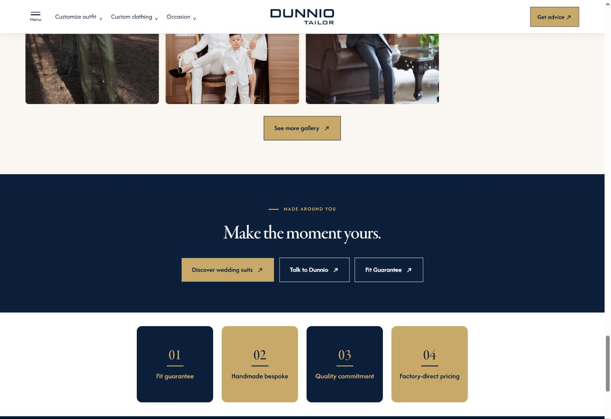
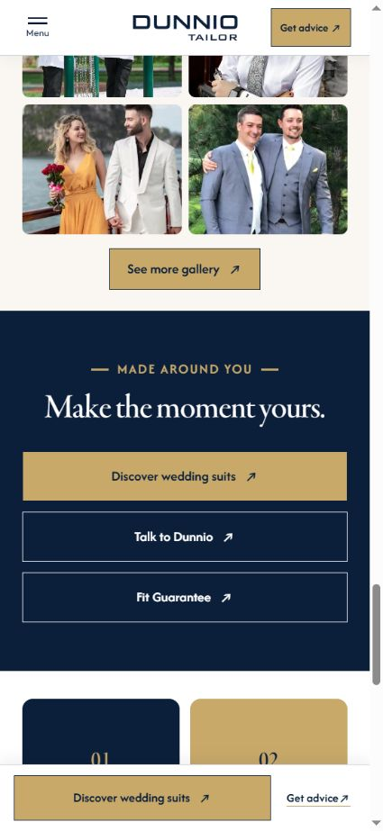

# Yêu cầu 23–24 — USP PC và CTA Fit Guarantee

Cập nhật 16/10/2026, chỉ áp dụng [Wedding Story v3.2](../v3.2-wedding-story.html).

- PC từ 1200 CSS px: bốn ô USP **180×180px**, khoảng cách 20px, cả hàng căn giữa. Padding 16px; số thứ tự và tiêu đề căn giữa. 180px cho phép giữ chữ rõ và đủ chỗ cho tiêu đề dài.
- Dưới 1200px: giữ nguyên lưới, kích thước, chữ và màu USP. Mobile giữ đường chéo navy 01/04, gold 02/03.
- Thêm **Fit Guarantee ↗** vào `.closing-section .actions`, bên cạnh hai CTA hiện có. URL: https://dunniotailor.com/fit-guarantee. Dùng kiểu button secondary hiện có; Mobile rộng theo cụm CTA, chữ không xuống dòng.
- Banner, video, footer và v3.1 không thay đổi.

Nguồn: `assets/wedding-final.css?v=request23-24-r1` và `tools/wedding-final.cjs`. Chạy `node tools/build-wedding-variants.cjs` để dựng HTML.

Đã đo Chrome ở 11 viewport: 320, 375, 440, 639, 640, 820, 1032, 1199, 1200, 1440, 1920px. Bốn ô PC đều 180px và nội dung nằm trong ô. CTA đúng URL, chữ một dòng, không tràn ngang. Bảy viewport Tablet/Mobile có dữ liệu trước đó đều giữ nguyên kích thước và màu USP. 1199px kiểm tra bổ sung tại biên PC. Đây là kiểm tra bằng trình duyệt desktop giả lập viewport, chưa phải kiểm tra thiết bị thật.

[Biên bản đo](wedding-usp-fit-verification.json)

