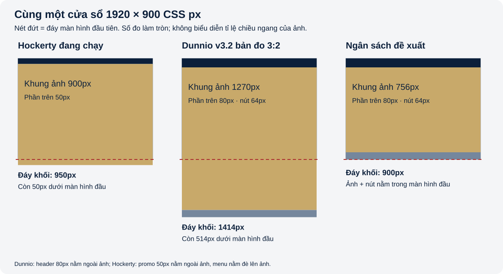
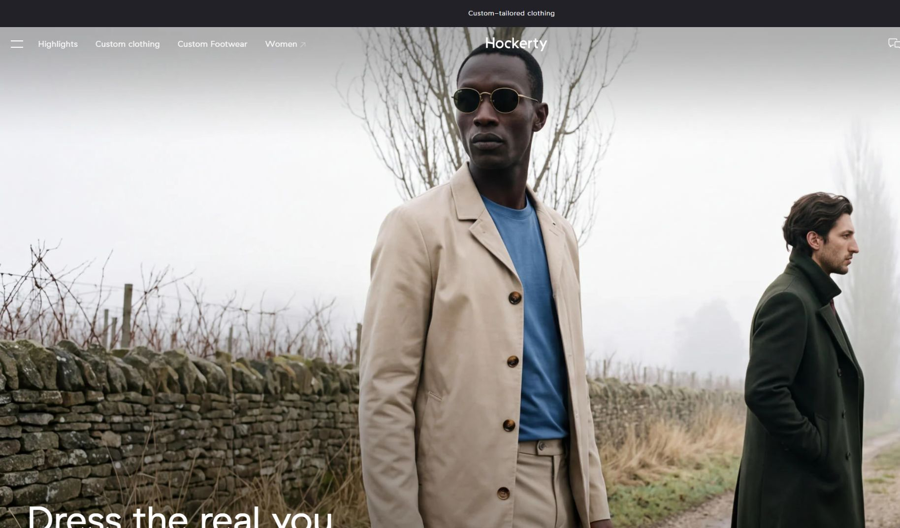
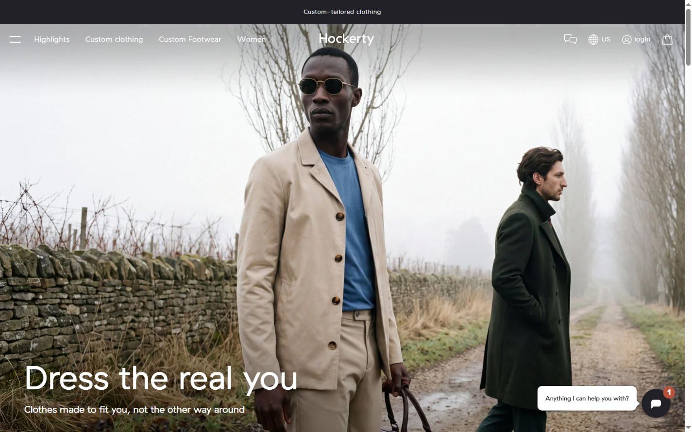
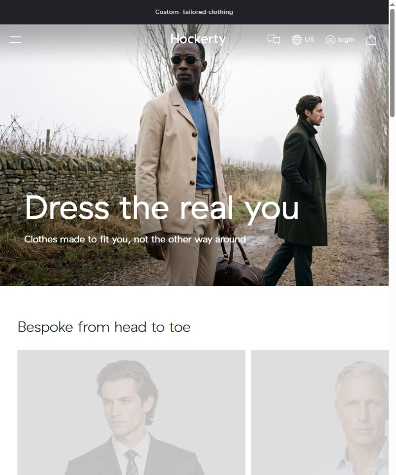
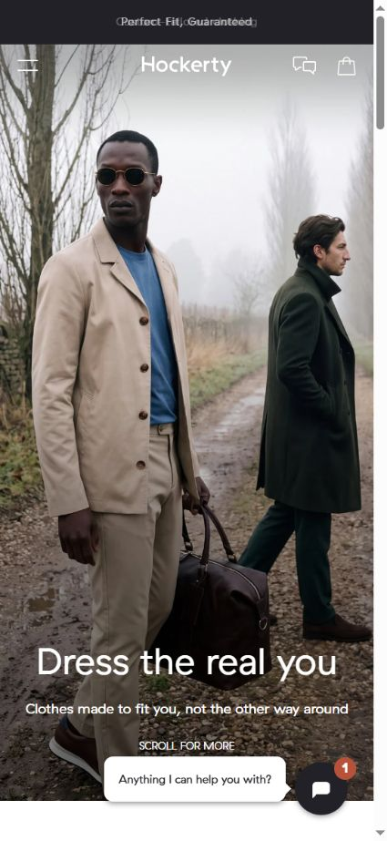
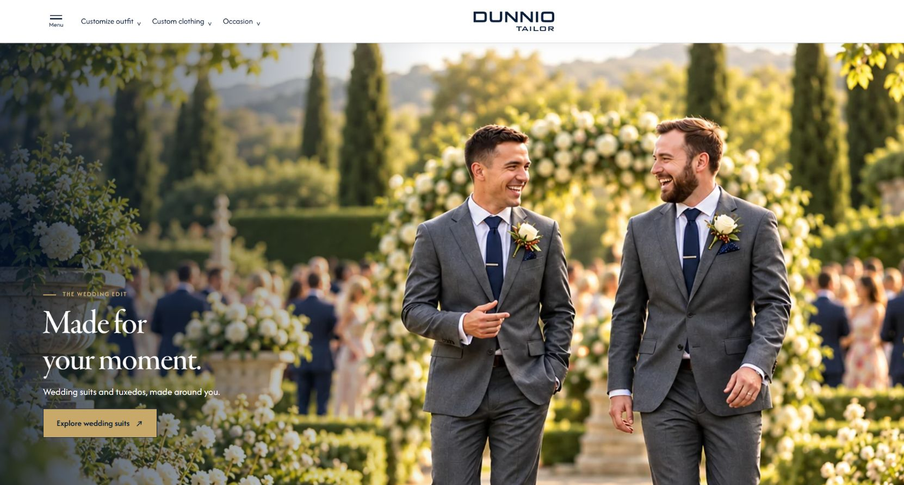
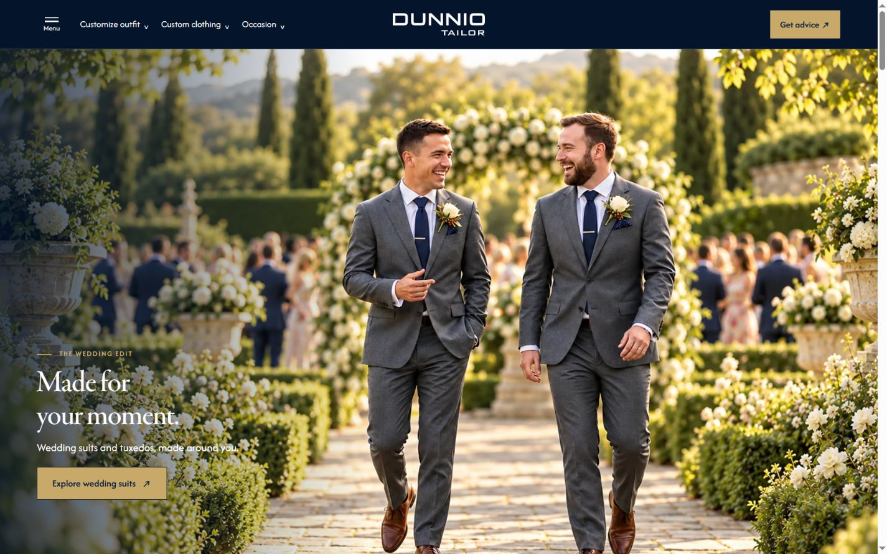
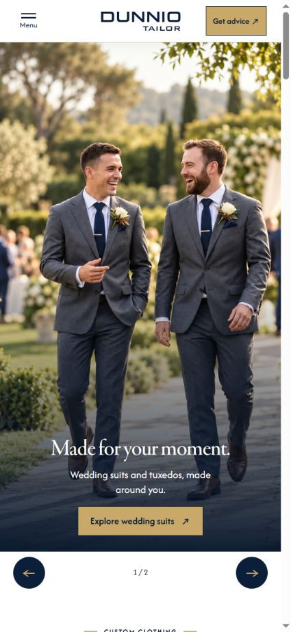

# Banner Hockerty và đề xuất responsive cho Dunnio Tailor

**Yêu cầu 19 · Kiểm tra ngày 15/10/2026, giờ Việt Nam.** Phạm vi đã chọn: báo cáo và đề xuất trước. Các cấu hình homepage đang chạy được giữ nguyên; chưa triển khai phương án mới trong báo cáo này.

> **Phạm vi lịch sử:** toàn bộ số đo và ảnh chụp Dunnio trong báo cáo này thuộc bản PC **3:2 trước Yêu cầu 20**. Bản hiện hành đã đổi sang **16:7**, slide 1 dùng **02-new**, slide 2 dùng **01**; Tablet 5:3 và Mobile hướng tới 4:7 giữ nguyên. Xem [thông số phiên bản hiện hành](VERSION-STATUS.html) và [manifest](VERSION-STATUS.json). Các đề xuất về chiều cao theo viewport dưới đây vẫn là đề xuất; không đọc các bảng 3:2 như số đo của bản 16:7.

## 1. Kết quả chính để ra quyết định

- Hockerty đang dùng **một hệ ảnh**, không phải một file cho mọi màn hình: ảnh PC thường gần **3:2**, ảnh panorama gần **2,133:1** (xấp xỉ 32:15), ảnh dọc mobile **1:2**.
- **Tỉ lệ ảnh nguồn khác tỉ lệ khung phát.** Ở PC, khung Hockerty không bị khóa vào 3:2 hoặc 16:9: chiều cao lấy mức nhỏ hơn giữa 66% chiều rộng viewport và toàn bộ chiều cao viewport. Ở ≤800px, chiều cao đổi thành 90% chiều cao viewport.
- Hockerty dùng background phủ kín khung và chấp nhận cắt mép ảnh. Họ điều chỉnh ảnh ngang/dọc, cỡ chữ, vị trí chữ và vị trí menu theo breakpoint. Đổi riêng tỉ lệ nguồn chưa tạo ra trải nghiệm tương đương.
- Dunnio v3.2 trong bản đo giữ nguyên toàn bộ ảnh PC 3:2, có header 80px và hàng nút 64px riêng. Ở viewport 1920×900, khối ảnh + nút kết thúc tại khoảng **1414px**: còn khoảng **514px** dưới màn hình đầu.
- Mục tiêu nên đo bằng **toàn bộ khung banner, chữ, CTA và nút chuyển ảnh cùng nằm trong viewport**, thay vì hứa “đúng một nấc chuột”. Nếu muốn giữ cả đầu và toàn bộ trang phục của ảnh hiện có, cần thu ảnh vừa ngân sách chiều cao hoặc thiết kế lại artwork ngang rộng; không ép ảnh 3:2 vào khung ngắn bằng cover mà không kiểm tra crop.

## 2. Nguồn, phương pháp và giới hạn

Đo trực tiếp [Hockerty US](https://www.hockerty.com/en-us/) và [Dunnio v3.2](https://tahieu98.github.io/2026-homepage-dunnio-tailor/v3.2-wedding-story.html). Hockerty trả 403 với công cụ trích xuất web thông thường, nhưng tải được bằng browser; báo cáo sử dụng DOM, CSS và số đo trong browser đó. Không suy kích thước từ ảnh chụp màn hình.

Đã đọc metadata của **12 file WebP** từ chính các URL CDN trong CSS hiện hành, đo **18 viewport Hockerty** và **12 viewport Dunnio**. Dữ liệu kiểm tra: [JSON đầy đủ](hockerty-banner-audit-20261015.json). Ảnh minh họa nằm ở mục 11.

Các kích thước hiển thị trong báo cáo dùng **CSS px**, không phải độ phân giải vật lý của màn hình. Browser thử nghiệm có scrollbar dọc khoảng 15px: viewport 1440px cho vùng ảnh rộng khoảng 1424,8px. Một vài giá trị có sai số dưới 1px do làm tròn viewport/scale. Đây là kiểm tra responsive bằng cách đổi viewport trên Chrome desktop; chưa phải thử nghiệm iPhone/iPad thật, Safari hay đo chuyển đổi bán hàng. Không khẳng định mọi khách truy cập đều nhận cùng chiến dịch, A/B test, cookie hoặc ngôn ngữ.

## 3. Ảnh banner Hockerty hiện có kích thước bao nhiêu?

Chiến dịch quan sát: thư mục CDN **2026/2026-10**. Ảnh là hai người mẫu mặc áo khoác màu be và xanh đậm. Kích thước dưới đây được đọc từ dữ liệu ảnh thực, không lấy tên file làm bằng chứng duy nhất.

| Nhóm rộng | Ảnh PC thường · gần 3:2 | Ảnh panorama · gần 2,133:1 | Dung lượng thường / panorama |
|---|---|---|---|
| 1024px | [dkt_1024.webp](https://d1fufvy4xao6k9.cloudfront.net/images/landing/hockerty/2026/2026-10/dkt_1024.webp) · 1024×683 | [dkt_1024_pan.webp](https://d1fufvy4xao6k9.cloudfront.net/images/landing/hockerty/2026/2026-10/dkt_1024_pan.webp) · 1024×480 | 99 / 80 KiB |
| 1200px | [dkt_1200.webp](https://d1fufvy4xao6k9.cloudfront.net/images/landing/hockerty/2026/2026-10/dkt_1200.webp) · 1200×800 | [dkt_1200_pan.webp](https://d1fufvy4xao6k9.cloudfront.net/images/landing/hockerty/2026/2026-10/dkt_1200_pan.webp) · 1200×562 | 118.8 / 100 KiB |
| 1500px | [dkt_1500.webp](https://d1fufvy4xao6k9.cloudfront.net/images/landing/hockerty/2026/2026-10/dkt_1500.webp) · 1500×1000 | [dkt_1500_pan.webp](https://d1fufvy4xao6k9.cloudfront.net/images/landing/hockerty/2026/2026-10/dkt_1500_pan.webp) · 1500×703 | 163.2 / 131.9 KiB |
| 1800px | [dkt_1800.webp](https://d1fufvy4xao6k9.cloudfront.net/images/landing/hockerty/2026/2026-10/dkt_1800.webp) · 1800×1200 | [dkt_1800_pan.webp](https://d1fufvy4xao6k9.cloudfront.net/images/landing/hockerty/2026/2026-10/dkt_1800_pan.webp) · 1800×844 | 201.3 / 164.4 KiB |
| 2500px | [dkt_2500.webp](https://d1fufvy4xao6k9.cloudfront.net/images/landing/hockerty/2026/2026-10/dkt_2500.webp) · 2500×1667 | [dkt_2500_pan.webp](https://d1fufvy4xao6k9.cloudfront.net/images/landing/hockerty/2026/2026-10/dkt_2500_pan.webp) · 2500×1172 | 298.4 / 251.5 KiB |

Chênh lệch 1px ở một số file do xuất ảnh/làm tròn; ví dụ 1024×683 không phải đúng tuyệt đối 3:2. Panorama **không phải 16:9**: 2500×1172 ≈2,133:1, trong khi 16:9≈1,778:1.

| Ảnh dọc | Kích thước thực | Tỉ lệ nguồn | Dung lượng |
|---|---|---|---|
| [mob_800.webp](https://d1fufvy4xao6k9.cloudfront.net/images/landing/hockerty/2026/2026-10/mob_800.webp) | 800×1600 | 1:2 | 130.8 KiB |
| [mob_1024.webp](https://d1fufvy4xao6k9.cloudfront.net/images/landing/hockerty/2026/2026-10/mob_1024.webp) | 1024×2048 | 1:2 | 177.8 KiB |

**Ví dụ lựa chọn thực tế:** 1440×900 dùng `dkt_1500.webp` 1500×1000. 1920×1080 dùng `dkt_2500_pan.webp` 2500×1172 ở lớp nền trên. 440×956 dùng `mob_800.webp` 800×1600. Do đó không có câu trả lời duy nhất kiểu “banner Hockerty luôn là 1920×1080”.

## 4. Khung phát banner PC của Hockerty có tỉ lệ bao nhiêu?

Gọi **Wv** là chiều rộng viewport, **Wc** là chiều rộng vùng nội dung thực sau scrollbar, **V** là chiều cao viewport, **H** là chiều cao khung hero.

Quy tắc quan sát từ CSS đang áp dụng:

- Trên 800px: **H = min(0,66 × Wv, V)**.
- Từ 800px trở xuống: **H = 0,90 × V**, vẫn chịu trần V.
- Tỉ lệ khung thực = **Wc / H**. Khung không có một tỉ lệ cố định chung cho PC/tablet/mobile.

| Viewport CSS | Khung hero thực W×H | Tỉ lệ khung (làm tròn) | Ảnh ở lớp nền trên | Khoảng còn dưới màn hình đầu |
|---|---|---|---|---|
| 1920×1080 | 1904.8×1080 | 1.764:1 | dkt_2500_pan.webp | 50px |
| 1920×900 | 1904.8×900 | 2.116:1 | dkt_2500_pan.webp | 50px |
| 1440×900 | 1424.8×900 | 1.583:1 | dkt_1500.webp | 50px |
| 1440×1000 | 1424.8×950.4 | 1.499:1 | dkt_1500.webp | 0.4px |
| 1366×768 | 1351.2×768 | 1.759:1 | dkt_1500_pan.webp | 50px |
| 1280×720 | 1264.8×720 | 1.757:1 | dkt_1500_pan.webp | 50px |
| 1032×1376 | 1016.8×681.1 | 1.493:1 | dkt_1200.webp | 0px |
| 1024×768 | 1008.8×675.8 | 1.493:1 | dkt_1024.webp | 0px |
| 820×1180 | 804.8×541.2 | 1.487:1 | dkt_1024.webp | 0px |
| 802×1180 | 786.4×529 | 1.486:1 | dkt_1024.webp | 0px |
| 800×1180 | 784.8×1062 | 0.739:1 | mob_1024.webp | 0px |
| 768×1024 | 752.8×921.6 | 0.817:1 | mob_1024.webp | 0px |
| 602×900 | 586.4×810 | 0.724:1 | mob_1024.webp | 0px |
| 600×900 | 584.8×810 | 0.722:1 | mob_800.webp | 0px |
| 440×956 | 424.8×860.4 | 0.494:1 | mob_800.webp | 0px |
| 390×844 | 375.2×759.6 | 0.494:1 | mob_800.webp | 0px |
| 375×667 | 360×600.5 | 0.6:1 | mob_800.webp | 0px |
| 844×390 | 828.8×390.4 | 2.123:1 | dkt_1024_pan.webp | 50.4px |

Trong mẫu đo này, dải thông điệp phía trên cao **50px**. Menu PC cao **65px**, nằm đè lên phần đầu ảnh, nên không được cộng thêm như một hàng layout ngoài hero. Vì hero bắt đầu tại y=50px, nhiều màn hình PC có đáy hero ở V+50px. Điều đó có nghĩa **Hockerty cũng chưa đặt nguyên cả khối promo + hero trong màn hình đầu ở mọi viewport**. Dẫu vậy, tiêu đề và mô tả được chừa khoảng cách tới đáy nên vẫn nằm trong vùng nhìn thấy ở các PC phổ biến đã đo. Phần ảnh bị menu che và phần ảnh bị cover cắt cũng không đồng nghĩa với việc người dùng xem được mọi pixel của ảnh gốc.

Ví dụ: 1920×1080 cho khung khoảng 1904,8×1080 (gần 16:9); 1440×900 cho khung 1424,8×900 (gần 1,583:1); 1920×900 cho khung 1904,8×900 (gần 2,116:1). Đây là hệ quả của ngân sách chiều cao, không phải ba tỉ lệ được gán cố định.

## 5. Hockerty thay ảnh và bố trí chữ theo responsive như thế nào?

| Điều kiện chiều rộng viewport | Ảnh nền WebP cơ sở |
|---|---|
| ≤600px | mob_800.webp · 800×1600 |
| 601–800px | mob_1024.webp · 1024×2048 |
| 801–1024px | dkt_1024.webp |
| 1025–1200px | dkt_1200.webp |
| 1201–1500px | dkt_1500.webp |
| 1501–1800px | dkt_1800.webp |
| ≥1801px | dkt_2500.webp |

Với nhóm ngang (>800px), khi **Wv/V ≥16/9**, CSS khai báo thêm file cùng cỡ có hậu tố **_pan** ở lớp background trên. Điều kiện này xét **tỉ lệ viewport**, không phải tỉ lệ ảnh nguồn hay khung hero. Chẳng hạn 1366×768 kích hoạt panorama, còn 1440×900 thì không. Hai URL background được khai báo thành hai lớp; không nên mô tả chúng như một `srcset` đảm bảo chỉ có một file tải về. Browser có hỗ trợ WebP dùng nhánh WebP; CSS còn có nhánh JPEG cho môi trường không hỗ trợ.

Ảnh nằm trong **div background**, không phải ảnh hero dạng `picture`. Khung ảnh được định vị tuyệt đối, vùng chứa cắt overflow; nền phủ kín theo cover. Vị trí nền quan sát là **0% 0%**, nên không được mặc định coi ảnh đang căn giữa. Quy tắc crop của cover được giải thích trong [MDN background-size](https://developer.mozilla.org/en-US/docs/Web/CSS/Reference/Properties/background-size).

| Nội dung | Trên 800px | ≤800px |
|---|---|---|
| Vị trí copy | Nằm trong hero, sát phía dưới | Nằm trong hero, sát phía dưới |
| Căn chữ | Trái | Giữa |
| Đệm copy | Trên 30px; hai bên 50px; dưới 60px | Trên 20px; hai bên 20px; dưới 40px |
| Tiêu đề chính | 70px; line-height 60px | 42px; line-height 40px |
| Mô tả phụ | 20px | 16px |
| Độ rộng vùng chữ | Tối đa 850px | Tối đa 850px, giới hạn bởi khung |
| Dòng gợi ý cuộn | Ẩn | Hiện |
| Eyebrow / nút prev-next trong hero đang quan sát | Không có | Không có |

Lớp gradient phía dưới hỗ trợ độ tương phản. Hiện hero có tiêu đề, mô tả và lời gợi ý cuộn; không có link CTA bán hàng trong hero đang quan sát. Trong script hiện hành, khi hero không có link, click vào hero sẽ cuộn tới khối sản phẩm. Đây là một hành vi click được quan sát trong mã nguồn; không phải bằng chứng rằng site bắt toàn bộ wheel để cuộn theo trang.

Một điểm đáng lưu ý: ở 800px, hero dùng 90vh và ảnh dọc; khi tăng qua 800px, nó chuyển sang 66vw và ảnh ngang. Đây là thay đổi mạnh, nên Hockerty không dùng một bố cục “tablet” duy nhất theo tên thiết bị. Màn hình 820px dọc đã nằm trong nhóm ngang, còn tablet 768px dọc nằm trong nhóm dọc.

## 6. Hockerty có hiển thị đầy đủ ảnh gốc không?

**Không nhất thiết.** Cover giữ tỉ lệ nhưng cắt phần dư để khớp khung. Việc thấy đủ khung hero khác với việc thấy nguyên ảnh nguồn. Với nguồn Sw×Sh và khung W×H:

`k = max(W/Sw, H/Sh)`; ảnh sau scale là `Sw×k, Sh×k`. Phần dư trên từng trục là kích thước sau scale trừ kích thước khung. Vị trí nền quyết định phần dư bị cắt ở mép nào.

Ví dụ tính hình học từ số đo và metadata:

- 1440×900, ảnh 1500×1000: khung 1424,8×900 cắt khoảng **5,25% chiều cao ảnh sau scale**. Với vị trí nền 0% 0%, phần dư chủ yếu nằm dưới.
- 1920×1080, ảnh panorama 2500×1172: khung 1904,8×1080 cắt khoảng **17,32% chiều rộng ảnh sau scale**, chủ yếu ở bên phải.
- Tablet 768×1024 dùng ảnh dọc 1024×2048 trong khung 752,8×921,6; mức crop dọc lớn hơn nhiều so với điện thoại. Vì vậy không thể lấy screenshot mobile đẹp để kết luận mọi tablet đều giữ nguyên toàn bộ ảnh.

Các tỉ lệ crop là tính toán hình học, không phải kết quả nhận diện người mẫu hay đánh giá phần trang phục nào đã mất. Cần xem ảnh thực ở từng khung trước khi áp dụng cho Dunnio.

## 7. Đối chiếu Dunnio v3.2 bản đo 3:2

Theo Yêu cầu 18, bản đang chạy dùng hai ảnh PC **1536×1024, 3:2**, header riêng **80px** từ 1200px, hàng chuyển ảnh riêng **64px**. Khung ảnh PC giữ nguyên tỉ lệ, nên chiều cao ảnh **Himg = Wc / 1,5**. Chữ/CTA được neo theo phần ảnh đang nhìn thấy, nhưng toàn bộ ảnh và hàng nút vẫn có thể kéo dài xuống dưới viewport.

Điểm cuối khối banner v3.2 trên PC là **80 + Himg + 64**. Đây là lý do không thể chỉ dựa vào việc “tiêu đề và CTA đã thấy” để kết luận cả banner đã vừa màn hình.

| Viewport | Hockerty: H ảnh | Hockerty: còn phải cuộn | Dunnio: H ảnh 3:2 | Dunnio: còn phải cuộn | Ngân sách ảnh nếu vừa màn hình |
|---|---|---|---|---|---|
| 1920×1080 | 1080px | 50px | 1269.9px | 333.9px | 936px |
| 1920×900 | 900px | 50px | 1269.9px | 513.9px | 756px |
| 1440×900 | 900px | 50px | 949.9px | 193.9px | 756px |
| 1440×1000 | 950.4px | 0.4px | 949.9px | 93.9px | 856px |
| 1366×768 | 768px | 50px | 900.8px | 276.8px | 624px |
| 1280×720 | 720px | 50px | 843.2px | 267.2px | 576px |

Ở 1920×900: Dunnio còn khoảng 514px, trong khi Hockerty còn 50px. Ở 1440×900: Dunnio còn khoảng 194px. Giữ nguyên 3:2 toàn chiều ngang và thêm hàng header/nút bên ngoài làm khối cao hơn thiết kế giới hạn theo viewport. Đây là giới hạn hình học, không phải lỗi GitHub chưa cập nhật ảnh.

Tablet v3.2 vẫn dùng ảnh **1600×960, 5:3** ở 640–1199px. Mobile dùng **file 1122×1402, gần 4:5**, đặt vào khung hướng tới **4:7**, có cap theo chiều cao viewport; vì dùng cover nên có crop. Như vậy **khung mobile 4:7 không có nghĩa file mobile là 4:7**.

| Viewport | Ảnh nguồn | Khung ảnh thực | Đáy hero + nút từ đầu trang | Position thực của copy |
|---|---|---|---|---|
| 1032×1376 | 1600×960 | 1016.8×610.1 | 738.1px | absolute |
| 820×1180 | 1600×960 | 804.8×482.9 | 610.9px | absolute |
| 768×1024 | 1600×960 | 752.8×451.7 | 579.7px | absolute |
| 440×956 | 1122×1402 | 424.8×770 | 898px | relative |
| 390×844 | 1122×1402 | 375.2×683.2 | 811.2px | relative |
| 375×667 | 1122×1402 | 360×539.2 | 667.2px | relative |

Trên mobile, `hero-copy-outside` có thể vẫn xuất hiện như một class do logic chung, nhưng CSS riêng của v3.2 bố trí copy theo grid bên trong hàng ảnh. Vì vậy báo cáo kiểm tra position và tọa độ thực, không chỉ đọc tên class. v3.1 vẫn là biến thể khác: ảnh PC 7:4, mobile 4:5 và copy dưới ảnh; báo cáo ngân sách ở trên tập trung vào v3.2 đang được tối ưu.

## 8. Mục tiêu UX nên định nghĩa lại bằng phép đo

“Một cuộn chuột” không có số pixel chung cho mọi chuột, trackpad, hệ điều hành và cài đặt. Wheel có thể báo đơn vị pixel, dòng hoặc trang; xem [MDN WheelEvent.deltaMode](https://developer.mozilla.org/en-US/docs/Web/API/WheelEvent/deltaMode). Cần phân biệt:

1. **Thấy đủ khung banner:** ảnh hiển thị, headline, CTA và nút chuyển ảnh cùng nằm trong viewport.
2. **Thấy nguyên ảnh gốc:** không cắt tóc, tay, gấu áo, quần hoặc bối cảnh; cần contain hoặc ảnh có tỉ lệ phù hợp.
3. **Một thao tác tới section tiếp theo:** có thể bổ sung link cuộn rõ ràng; vẫn giữ thao tác cuộn tự nhiên.

Đề xuất đặt mục tiêu mạnh hơn cho PC tiêu chuẩn: **0 lần cuộn để thấy đủ khung ảnh + nội dung + nút**. Nếu muốn tới sản phẩm bằng một thao tác chắc chắn, cung cấp link tới collection. Không dùng `preventDefault` trên wheel để ép tất cả người dùng sang section khác.

## 9. Đề xuất responsive cho Dunnio — chưa triển khai

### 9.1. Chốt ngân sách chiều cao trước, rồi chọn cách đặt ảnh

Gọi N là tổng chiều cao các phần ngoài ảnh phía trên, C là hàng nút, P là phần hé section sau (mặc định 0), V là chiều cao viewport an toàn. Ngân sách ảnh **B = V − N − C − P**. Với v3.2 PC hiện tại: N=80px, C=64px. Nếu sau này có promo bar ngoài banner, cộng nó vào N đúng một lần. Header đặt đè lên ảnh thì không trừ hai lần.

| Viewport | B ảnh tối đa (P=0) | Tỉ lệ khung ngang nếu phủ kín | Nếu crop ảnh 3:2: mất chiều cao | Nếu giữ nguyên ảnh: rộng ảnh / rộng trang |
|---|---|---|---|---|
| 1920×1080 | 936px | 2.035:1 | 26.3% | 1404px / 1904.8px |
| 1920×900 | 756px | 2.52:1 | 40.5% | 1134px / 1904.8px |
| 1440×900 | 756px | 1.885:1 | 20.4% | 1134px / 1424.8px |
| 1440×1000 | 856px | 1.664:1 | 9.9% | 1284px / 1424.8px |
| 1366×768 | 624px | 2.165:1 | 30.7% | 936px / 1351.2px |
| 1280×720 | 576px | 2.196:1 | 31.7% | 864px / 1264.8px |

Các hàng này là **tính toán đề xuất**, chưa phải giao diện được triển khai. Giới hạn chiều cao phải được giải quyết trước khi chọn tỉ lệ cố định 3:2, 16:9 hay 7:4. Ở 1920×900, thậm chí 16:9 toàn chiều ngang cũng có thể cao quá khi cộng header và nút.

### 9.2. Hai phương án nên đưa ra duyệt

| Phương án | Cách đặt ảnh | Ưu điểm | Đánh đổi / điều kiện |
|---|---|---|---|
| A · Ưu tiên nguyên ảnh hiện có | Giới hạn khung theo B; contain ảnh 3:2; bố trí nền navy/gold và khoảng trống có chủ ý | Giữ đầy đủ người mẫu và trang phục; ảnh/nút nằm trong một viewport | Ảnh không luôn tràn kín chiều ngang. Có thể bố trí copy ở cột trái, ảnh ở phải; cần dàn lại, không chỉ đổi object-fit |
| B · Ưu tiên ảnh tràn ngang như Hockerty | Khung theo B; dùng bộ artwork ngang thường/panorama; cover với vùng an toàn theo slide | Hiệu ứng ảnh lớn, full bleed; banner gọn theo viewport | Cần ảnh rộng được dàn lại hoặc crop đã duyệt. Ảnh 3:2 hiện có sẽ bị crop mạnh ở màn hình rộng, thấp |

**Khuyến nghị trước mắt:** nếu “trọn vẹn” bao gồm nguyên đầu, tay và toàn bộ bộ suit trong hai ảnh hiện có, ưu tiên duyệt **A**. Nếu muốn full bleed gần Hockerty, chọn **B** sau khi chuẩn bị artwork ngang và kiểm tra crop; không áp dụng cover mạnh lên ảnh 3:2 một cách tự động. Bản 3:2 hiện tại có thể tiếp tục giữ như một phương án so sánh, nhưng không đạt tiêu chí vừa một viewport ở mọi PC.

### 9.3. Cách lập khung và xử lý các thiết bị

- **PC ≥1200px:** dùng khung hero tổng cao tối đa V−N; chia hàng ảnh có thể co và hàng nút 64px. Header giữ vị trí đã duyệt. Nút và CTA phải có chỗ riêng trong ngân sách, không đẩy ra ngoài bằng margin/padding phát sinh. Ratio hiển thị được phép thay đổi khi viewport thấp nếu duyệt phương án B.
- **Tablet 640–1199px:** giữ artwork 5:3 hiện tại làm nền tảng. Kiểm tra thêm chiều cao và hướng màn hình; 1032×1376 và 1024×768 có cùng khoảng rộng nhưng ngân sách dọc khác. Không ép tablet dọc và ngang vào một preset chỉ dựa trên tên thiết bị.
- **Mobile ≤639px:** giữ cách đặt copy gần chân ảnh và hai nút dưới ảnh của v3.2. Khung hướng tới 4:7, vẫn giới hạn theo chiều cao an toàn. Nên chuẩn bị artwork dọc gần khung đích nếu muốn giảm crop so với file 4:5 hiện dùng. Khi chữ phóng lớn hoặc landscape quá thấp, cho phép layout dài hơn để đọc/nhấn được, thay vì cắt hoặc ẩn CTA.
- **Viewport units:** desktop dùng chiều cao viewport thực; với mobile cân nhắc svh cho khung ổn định khi thanh địa chỉ xuất hiện. dvh theo chiều cao động và có thể làm khung đổi theo thanh trình duyệt. Đây là lựa chọn kỹ thuật cần test Safari/Chrome thật, không chỉ Inspect. Xem [MDN về đơn vị chiều dài](https://developer.mozilla.org/en-US/docs/Web/CSS/Reference/Values/length).

### 9.4. CMS, vùng an toàn và mã hiện hành cần cập nhật đồng bộ

Mỗi slide nên lưu: artwork desktop thường, desktop rộng nếu có, tablet, mobile; width/height thật; alt; điểm lấy nét; bounding box người mẫu; vùng cấm đặt chữ. Dùng [picture và source](https://developer.mozilla.org/en-US/docs/Web/HTML/Reference/Elements/picture) để tách art direction, rồi srcset/sizes để chọn độ phân giải phù hợp.

Với cover: scale `k=max(W/Sw,H/Sh)`; nếu điểm neo chuẩn hóa là px/py, phần bù crop lần lượt là `(W−Sw×k)×px` và `(H−Sh×k)×py`. Bounding box phải được nhân k và cộng phần bù này trước khi kiểm tra va chạm với copy. Với contain dùng k nhỏ hơn và tính thêm khoảng trống.

Logic fit hiện trong `assets/app.js` đang dùng tọa độ subject theo khung ảnh hiển thị. Khi đổi desktop sang cover hoặc contain có letterbox, phải cập nhật cách quy đổi tọa độ và fallback cùng lúc; nếu chỉ thêm max-height/object-fit, có thể phát sinh chữ che người mẫu hoặc fallback đẩy copy xuống, làm khối lại vượt chiều cao dự kiến. Đo lại sau font load, đổi slide, resize và zoom chữ.

Ảnh nguồn PC hiện tại chỉ rộng 1536px; hiển thị toàn chiều ngang 1920px đã là phóng lớn. Nếu muốn ảnh sắc hơn trên màn hình rộng/DPR cao, cần file gốc độ phân giải lớn hơn hoặc thiết kế lại từ nguồn đủ chất lượng. Xuất lại file hiện có thành 3000px không tạo thêm chi tiết thật.

## 10. Tiêu chí nghiệm thu cho bước triển khai sau

| Nhóm kiểm tra | Điều kiện đạt |
|---|---|
| PC thông dụng | Ở 1280×720, 1366×768, 1440×900, 1920×900 và 1920×1080: header + khung hero + hàng nút không vượt viewport quá 1px trong chế độ vừa màn hình |
| Ảnh và typography | Không kéo méo ảnh; toàn bộ nội dung quan trọng trong vùng an toàn đã duyệt; chữ dễ đọc; CTA không đè người mẫu |
| Nút điều khiển | Hai nút ít nhất 48×48px, đủ khoảng hở; có nhãn truy cập; counter cập nhật; focus ring không bị cắt |
| Hai slide / đổi thiết bị | Kiểm tra cả hai slide, load chậm, resize qua 1199/1200px và 639/640px; luôn lấy đúng artwork và kích thước |
| Tablet / mobile | Kiểm tra 1032×1376, 820×1180, 1024×768, 440×956, 390×844, 375×667, landscape thấp và browser thật |
| Khả năng đọc | Zoom/text 200%, bàn phím, reduced motion: ưu tiên đọc và thao tác được; cho phép fallback cao hơn thay vì ép mất nội dung |
| Cuộn trang | Không khóa wheel/touch; link tới collection hoạt động; luôn cuộn tới footer; đóng menu khôi phục cuộn |
| Performance | Đặt đúng width/height; ảnh đầu ưu tiên tải, slide sau tải có kiểm soát; đo LCP/CLS bằng công cụ và mạng thực trước khi tuyên bố cải thiện |
| Inspect | Đặt đúng chiều rộng CSS và Fit to window; phân biệt vùng trang với toàn bộ cửa sổ chứa DevTools |

Chưa có đo lường chứng minh tăng chuyển đổi. Sau khi triển khai và kiểm tra hình học, có thể so sánh tỷ lệ thấy CTA, click CTA, chuyển slide, cuộn vào collection và LCP/CLS trên dữ liệu thật.

## 11. Ảnh kiểm tra và dữ liệu bàn giao

Ảnh chụp là bằng chứng của trang đang chạy tại ngày kiểm tra; không phải bản demo đề xuất. Bấm từng mục để mở ảnh trong bản HTML.

Hockerty PC · 1920×1080

Hockerty PC · 1920×1080: viewport CSS được đối chiếu trước khi chụp.

Hockerty PC · 1440×900

Hockerty PC · 1440×900: viewport CSS được đối chiếu trước khi chụp.

Hockerty tablet · 820×1180

Hockerty tablet · 820×1180: viewport CSS được đối chiếu trước khi chụp.

Hockerty mobile · 440×956

Hockerty mobile · 440×956: viewport CSS được đối chiếu trước khi chụp.

Dunnio v3.2 PC · 1920×900

Dunnio v3.2 PC · 1920×900: viewport CSS được đối chiếu trước khi chụp.

Dunnio v3.2 PC · 1440×900

Dunnio v3.2 PC · 1440×900: viewport CSS được đối chiếu trước khi chụp.

Dunnio v3.2 mobile · 440×956

Dunnio v3.2 mobile · 440×956: viewport CSS được đối chiếu trước khi chụp.

- [Dữ liệu đo 30 viewport và metadata 12 file ảnh](hockerty-banner-audit-20261015.json).
- [Sơ đồ ngân sách chiều cao SVG](hockerty-banner-audit-20261015.svg).
- [Thông số editor hiện có](BANNER-EDITOR-SPEC.md) và [lịch sử công thức responsive](RESPONSIVE-BANNER-FORMULA.md).
- [Hockerty US](https://www.hockerty.com/en-us/) là nguồn chính về giao diện đang quan sát; từng file ảnh chính chủ đã được liên kết ở mục 3.

## 12. Quyết định đề xuất

Học từ Hockerty ở **giới hạn chiều cao theo viewport, tách artwork theo hình dáng màn hình và giữ chữ trong khung**. Không sao chép một con số tỉ lệ duy nhất từ ảnh nguồn rồi kỳ vọng mọi PC đều vừa màn hình.

Tại thời điểm khảo sát trước Yêu cầu 20, với Dunnio v3.2 cần duyệt trước việc ưu tiên **nguyên ảnh 3:2** hay **ảnh tràn ngang trong một viewport**. Phương án nguyên ảnh có bố cục nền/cột chủ ý là lựa chọn an toàn cho bộ ảnh hiện có; phương án full bleed cần artwork và crop được duyệt. Báo cáo này hoàn thành bước đo và đề xuất; chưa thay đổi tỉ lệ hay CSS của homepage đã duyệt.
